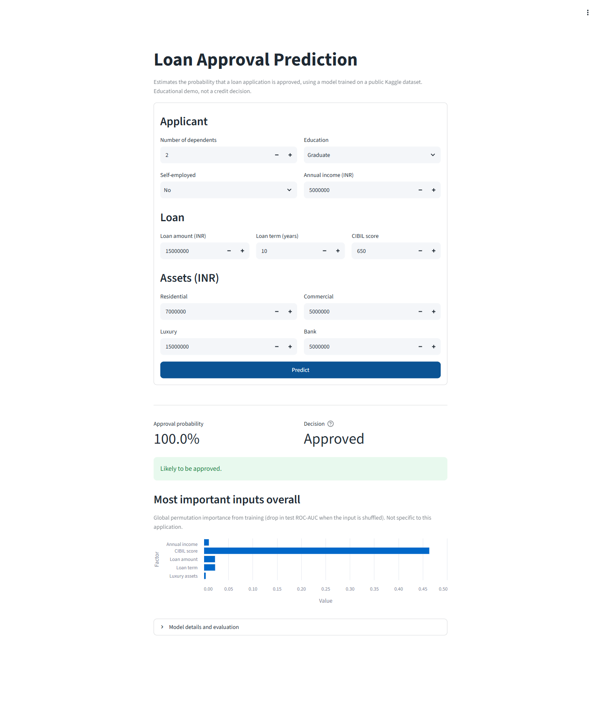
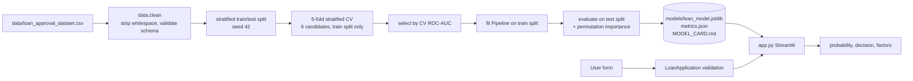
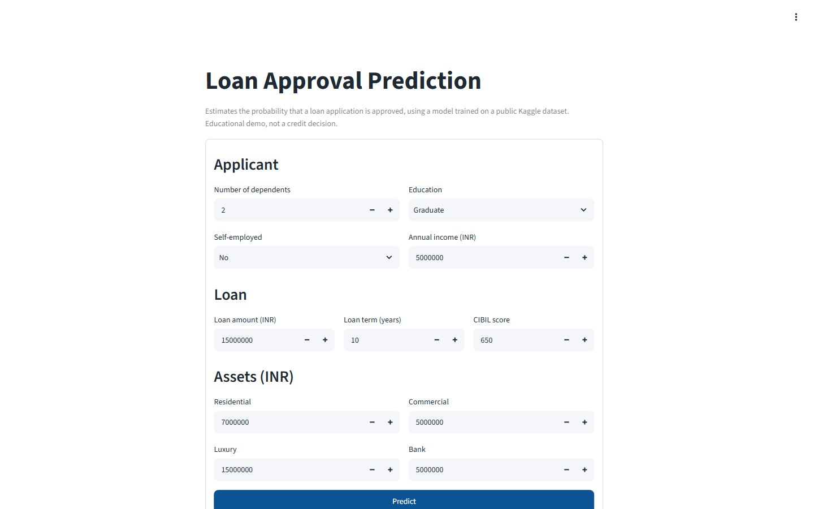
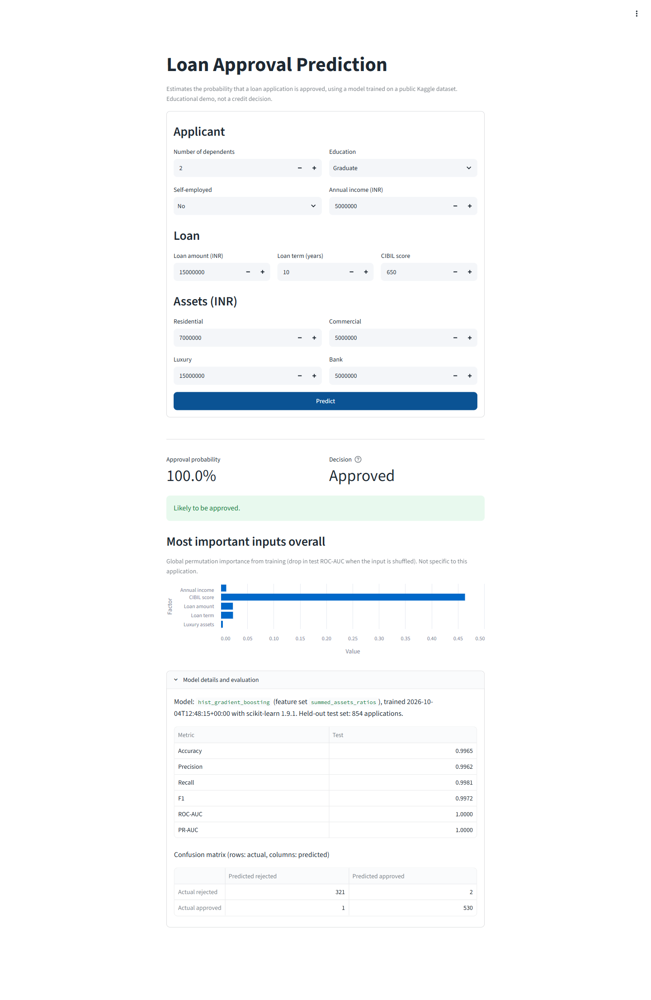

# Loan Approval Prediction

A reproducible scikit-learn pipeline and Streamlit app that estimates the probability of a loan application being approved.



## Overview

Lenders screen applications on income, loan size, term, credit score and assets. This project trains a binary classifier on a public loan approval dataset (4,269 applications) and serves it through a web form that returns an approval probability, a decision, and the inputs that matter most.

Training is a single command that compares candidate models with cross-validation, then writes one versioned model artifact, a metrics file and a model card generated from those metrics. The app, training code and tests share one small Python package.

## Features

- Web form for one application; returns approval probability, decision and top factors
- One-command training (`python -m loan_approval.train`) that compares candidate models with cross-validation and writes the artifact, `metrics.json` and `MODEL_CARD.md`
- Input validation (allowed categories, CIBIL 300-900, positive income and loan amount, non-negative assets)
- Model metrics shown in the app, read from `models/metrics.json` at runtime (nothing hard-coded)
- Traceability: `metrics.json` records the sklearn version, training timestamp, SHA-256 of the dataset, chosen model, features and decision threshold
- 22 pytest tests, including an encoding regression test, a CIBIL monotonicity check on the shipped artifact and a Streamlit `AppTest` smoke test

## Architecture



Inside the saved pipeline: `FunctionTransformer(build_features)` -> `ColumnTransformer(OneHotEncoder, StandardScaler)` -> classifier.

## Tech Stack

- **Language:** Python 3.11
- **ML / data:** scikit-learn, pandas, NumPy, joblib
- **App:** Streamlit
- **Quality:** pytest, ruff

## Project Structure

```
loan-approval-prediction/
├── app.py                      # Streamlit entry point (used by Streamlit Cloud)
├── loan_approval/
│   ├── config.py               # paths, schema, features, seed, thresholds
│   ├── data.py                 # load, clean, validate, build_features
│   ├── train.py                # CV comparison, final fit, evaluation, artifacts
│   └── predict.py              # LoanApplication, load_model, predict, explain
├── models/
│   ├── loan_model.joblib       # trained pipeline (committed for deployment)
│   ├── metrics.json            # metrics and metadata from the last training run
│   └── MODEL_CARD.md           # generated model card
├── data/loan_approval_dataset.csv
├── notebooks/Loan_Approval_Pred_Model.ipynb   # exploratory notebook
├── tests/                      # pytest suite (data, predict, train, app)
├── screenshots/                # images used in this README
├── .streamlit/config.toml      # theme
├── .devcontainer/devcontainer.json
├── requirements.txt / requirements-dev.txt
├── pyproject.toml              # ruff + pytest config
└── .env.example
```

## How It Works

1. `data.clean` strips the leading spaces present in the CSV headers and values (for example `" Graduate"`), drops `loan_id`, and raises a `SchemaError` on missing columns, nulls, unknown categories or non-numeric values.
2. `build_features` sums the four asset columns into `total_assets` and adds `loan_to_income` and `loan_to_assets` ratios (the feature set chosen by CV).
3. The pipeline one-hot encodes `education` and `self_employed` and standardises the numeric features.
4. At prediction time, `LoanApplication` validates the form input and the pipeline returns P(approved). The decision uses a 0.5 threshold, stored in `metrics.json`.
5. Explanations: for logistic regression, the app shows exact per-feature contributions to the log-odds (coefficient x scaled value). The shipped model is gradient boosting, which has no such decomposition, so the app shows global permutation importances from training and labels them as global.

## Installation

```bash
git clone <YOUR_GITHUB_REPOSITORY_URL> loan-approval-prediction
cd loan-approval-prediction
python -m venv .venv
```

Activate the environment:

```bash
# Windows (PowerShell)
.venv\Scripts\Activate.ps1
# Windows (cmd)
.venv\Scripts\activate.bat
# macOS / Linux
source .venv/bin/activate
```

Install dependencies:

```bash
pip install -r requirements.txt        # app + training
pip install -r requirements-dev.txt    # adds pytest and ruff
```

## Configuration

No configuration is required. Optionally, `LOAN_MODEL_PATH` points the app at a different artifact (`metrics.json` is read from the same folder). See `.env.example`.

## Usage

```bash
python -m loan_approval.train          # train; writes models/
streamlit run app.py                   # open http://localhost:8501
pytest                                 # run tests
ruff check .                           # lint
ruff format --check .                  # formatting check
```

`python -m loan_approval.train --sample 800 --out-dir scratch_models` runs a quick training on a stratified subsample without touching `models/`.

## Model and Data

- **Dataset:** `data/loan_approval_dataset.csv`, 4,269 rows, no missing values, 62.2% approved.
- **Inputs:** `no_of_dependents`, `education`, `self_employed`, `income_annum`, `loan_amount`, `loan_term` (years, 2-20 in the data), `cibil_score`, and four asset values (residential, commercial, luxury, bank).
- **Target:** `loan_status` (Approved = 1, Rejected = 0).
- **Split:** stratified 80/20, seed 42: 3,415 train / 854 test.
- **Cross-validation:** stratified 5-fold on the training split only. The held-out test set is used once, for the final evaluation.
- **Models compared:** `LogisticRegression` (baseline) and `HistGradientBoostingClassifier`.
- **Feature sets compared:** assets summed, assets kept separate, and assets summed plus loan-to-income and loan-to-assets ratios (6 candidates in total).
- **Selection:** highest mean 5-fold CV ROC-AUC. If candidates are within 0.001 of the best, the simplest one wins. ROC-AUC is used because it does not depend on the threshold and the classes are moderately imbalanced. F1 and PR-AUC are reported alongside it.
- **Constraint:** the gradient boosting model is constrained to be monotonic increasing in CIBIL score (`monotonic_cst={"cibil_score": 1}`).
- **Explanations:** exact per-feature log-odds contributions for logistic regression; for the shipped gradient boosting model, global permutation importances from training, labelled as global.

## Results

All figures are from `models/metrics.json` (scikit-learn 1.9.1, trained 2026-10-04).

**Cross-validation (5-fold stratified, training split only)**

| Candidate | ROC-AUC | F1 | Accuracy |
|---|---|---|---|
| logistic_regression / summed_assets | 0.9666 ± 0.0082 | 0.9312 ± 0.0129 | 0.9142 |
| logistic_regression / separate_assets | 0.9663 ± 0.0082 | 0.9313 ± 0.0129 | 0.9142 |
| logistic_regression / summed_assets_ratios | 0.9678 ± 0.0093 | 0.9257 ± 0.0164 | 0.9075 |
| hist_gradient_boosting / summed_assets | 0.9967 ± 0.0024 | 0.9869 ± 0.0016 | 0.9836 |
| hist_gradient_boosting / separate_assets | 0.9979 ± 0.0014 | 0.9885 ± 0.0032 | 0.9857 |
| **hist_gradient_boosting / summed_assets_ratios** (selected) | **0.9999 ± 0.0001** | **0.9962 ± 0.0024** | **0.9953** |

For logistic regression, keeping the four asset columns separate made no difference compared with summing them. For gradient boosting, the loan-to-income and loan-to-assets ratios gave the largest gain.

**Held-out test set (854 applications)**

| Accuracy | Precision | Recall | F1 | ROC-AUC | PR-AUC |
|---|---|---|---|---|---|
| 0.9965 | 0.9962 | 0.9981 | 0.9972 | 0.99997 | 0.99998 |

Precision, recall and F1 are for the Approved class.

Confusion matrix:

| | Predicted rejected | Predicted approved |
|---|---|---|
| **Actual rejected** | 321 | 2 |
| **Actual approved** | 1 | 530 |

**Permutation importance** (drop in test ROC-AUC): `cibil_score` 0.4636, `loan_term` 0.0227, `loan_amount` 0.0225, `income_annum` 0.0098. All asset columns are 0.0034 or below. `education`, `self_employed` and `no_of_dependents` are about 0.

## Screenshots

Captured from the app running locally with the committed model.

### Application form



### Prediction and model details



## Deployment

The app is set up for Streamlit Community Cloud with `app.py` at the repository root. Select Python 3.11 or newer in the app settings. Streamlit Cloud installs `requirements.txt` and imports the `loan_approval` package from the repository root, so the package does not need to be installed. `models/` is committed so the app can load the artifact without retraining; after retraining, commit the updated `models/` folder.

A live instance is at https://loan-approval-prediction-ab49dxfr7kjmv6jpbbr9aa.streamlit.app/ and updates when the connected repository is redeployed. Deployment of the current code has not been tested.

## Design Decisions

- **Encoding only inside the pipeline.** The app passes the dataset's own string labels (`"Graduate"`, `"Yes"`) and all encoding happens inside the saved pipeline, so the app and training code cannot encode differently. A regression test checks that the model receives the raw labels unchanged and that the pipeline encodes them as in training.
- **Single artifact.** Feature engineering, preprocessing and the classifier are saved as one joblib pipeline, with the sklearn version recorded in `metrics.json`, so there are no separate scaler and model files to keep in sync.
- **Reproducible split.** The train/test split is stratified, seeded (42) and recorded.
- **Monotonic CIBIL constraint.** Approval probability should not fall as credit score rises. When probed, the unconstrained gradient boosting model was not monotonic in CIBIL score on any of 214 applications, so the constraint is applied and model selection runs with it. A test checks monotonicity on the shipped artifact.
- **Single-threaded training.** `HistGradientBoostingClassifier` ran about 25x slower on Windows because of OpenMP thread oversubscription. Training and tests run single-threaded via `threadpoolctl`, which is fast enough for 4k rows.

## Limitations

- **The near-perfect scores reflect the dataset, not real-world performance.** The data comes from a public Kaggle dataset that looks synthetic, and CIBIL score alone accounts for most of the predictive signal; approval looks close to a deterministic rule on CIBIL, term, amount and income. These results must not be read as evidence of real-world lending performance.
- The dataset has no provenance, time dimension or information on rejected-applicant outcomes.
- Not for credit decisions. The model has not been validated, calibrated for a real portfolio, or checked against lending regulations.
- No fairness audit has been done. The dataset has no protected attributes, but education, self-employment and dependents can act as proxies. A real system would need bias testing, adverse-action reason codes and human review.

## Future Improvements

- Probability calibration check (reliability curve) and a cost-based decision threshold
- Local explanations for the tree model (for example SHAP) instead of global importances
- Evaluation on a more realistic credit dataset
- CI workflow running ruff and pytest on every push

## Author

Arpita Khobragade - GitHub: https://github.com/A08rpita0
